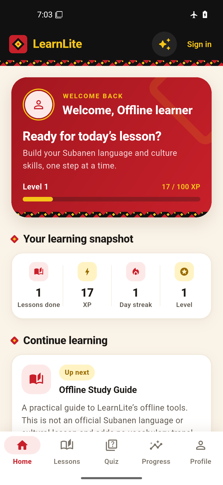
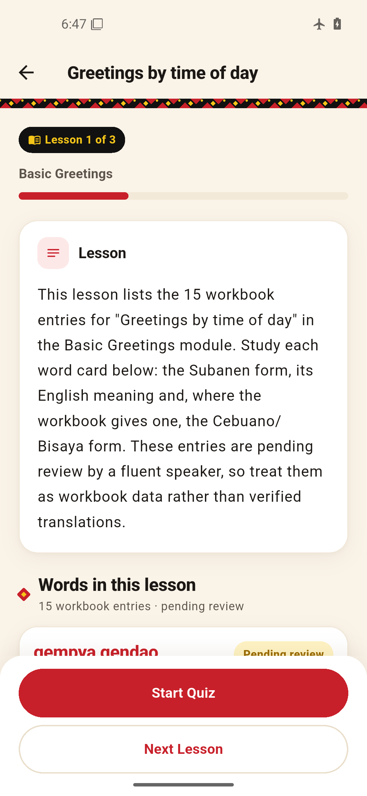
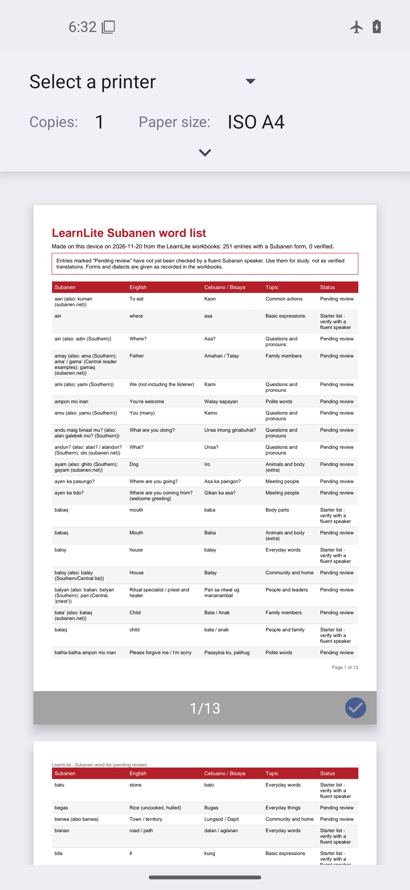
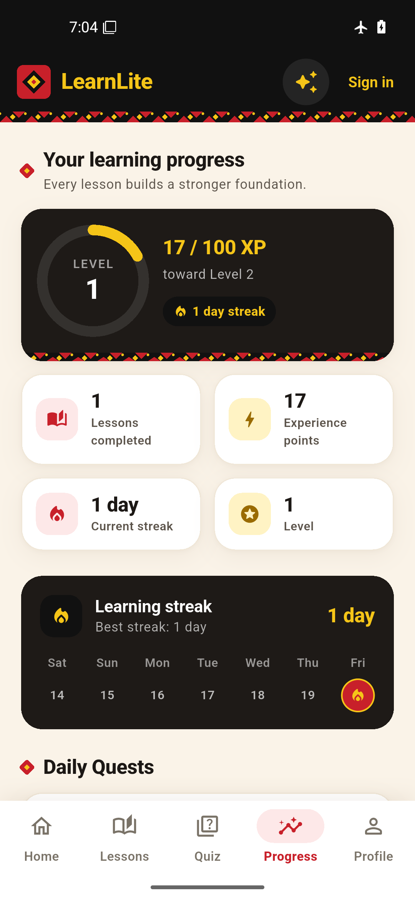

# LearnLite

LearnLite is an Android app for learning the Subanen language and culture.
Lessons, vocabulary, quizzes and progress work **fully offline** on the phone.
An optional AI Tutor answers study questions using a small local AI model
(`qwen2.5:3b` through Ollama) that runs on a classroom computer on the same
network.

> **About the vocabulary.** Every Subanen entry comes from the project's
> workbooks and is shown with its review status. All entries are currently
> **pending review by a fluent speaker**. LearnLite never generates Subanen
> words, translations or pronunciations, and the Tutor is instructed not to.

## Features

| Area | What it does |
|---|---|
| Lessons | 5 workbook modules (Basic Greetings, Family & Community, Numbers & Counting, Everyday Phrases, Culture & Traditions) with 19 lessons, plus an Offline Study Guide. Each lesson shows its workbook entries as word cards and has a quiz built from those entries. |
| Practice | Flashcards, a vocabulary quiz in both directions (English → Subanen and Subanen → English), filters by workbook module, category and source. |
| Dictionary | Searches all bundled workbook entries offline, verified entries first, each labelled "Verified" or "Pending review". |
| Word list PDF | Offline downloads → "Subanen word list (PDF)": made on the phone from the workbooks, every entry with its review status; opens, prints, saves and shares without internet. |
| Progress | XP, levels, daily streaks, daily quest, weekly chest, badges, quiz history and per-module progress, all stored on the device. |
| Accounts | Firebase email/password sign-in with email verification. An offline guest mode keeps its own separate progress. |
| Avatar | Build a drawn avatar (female or male; skin tone, hair, outfit colour, woven band, beads, earrings, head cloth, background) in LearnLite's red, gold and black woven style. No photo upload; drawn on the phone, works offline. An inspired design, not official Subanen attire. |
| AI Tutor | Optional. Sends the learner's question, plus any matching workbook entries labelled as unverified, to the classroom computer. |

| Home | Lesson | Word list PDF (offline) | Progress |
|---|---|---|---|
|  |  |  |  |

More in [docs/screenshots](docs/screenshots/).

## Architecture

```
Phone (Flutter app)
 ├─ SQLite (learnlite.db) ── all lessons, vocabulary, progress, quiz results
 ├─ Firebase Authentication ── sign-in only (no cloud database)
 └─ AI Tutor (optional) ──HTTP──> classroom PC: backend/learnlite_api ──> Ollama qwen2.5:3b
```

| Layer | Technology | Notes |
|---|---|---|
| App | Flutter 3.47 (`mobile/`) | All UI and logic. |
| Data | SQLite via `sqflite` | The only learning data store. Bundled workbooks are imported on first launch. |
| Identity | Firebase Authentication, project `learnlite-f1dd5` | Used only for accounts. |
| Tutor bridge | `backend/learnlite_api` (FastAPI) | Used only for `POST /ai/chat`. |
| AI model | Ollama, `qwen2.5:3b` | Runs on the classroom PC. |

## Repository layout

| Path | Contents |
|---|---|
| `mobile/lib/app/` | Theme, colours, navigation shell |
| `mobile/lib/core/` | SQLite database, workbook module generator, helpers |
| `mobile/lib/features/` | Screens by feature (auth, modules, content, dashboard, profile, rewards, settings, tutor, admin) |
| `mobile/lib/widgets/` | Shared design-system widgets |
| `mobile/assets/vocabulary/` | The bundled workbook data (JSON exports of the Excel workbooks) |
| `mobile/test/` | Unit and widget tests |
| `mobile/integration_test/` | Device tests (account flows against the Firebase Auth emulator) |
| `docs/` | Emulator test report and screenshots |
| `OWNER_ACTIONS.md` | Steps that need the owner's accounts, inbox or phone |
| `mobile/tool/verify.ps1` | Analyze, test and build in a temp copy (see below) |
| `backend/` | The Tutor bridge and its tests |
| `MASTER_ROADMAP.md`, `PHASE_PROGRESS.md`, `SYSTEM_AUDIT.md`, `IMPLEMENTATION_NOTES.md` | Project plan, status, audit findings and developer notes |

## Build and test the app

Requirements: Flutter 3.47 (stable), Android SDK, a device or emulator.

```powershell
cd mobile
flutter pub get
flutter run                       # debug build on a connected device
```

If the project sits in a OneDrive folder, OneDrive locks `mobile/build/`. Use
the verification script, which works in `%TEMP%\learnlite_verify`:

```powershell
powershell -NoProfile -ExecutionPolicy Bypass -File mobile\tool\verify.ps1          # pub get, analyze, tests
powershell -NoProfile -ExecutionPolicy Bypass -File mobile\tool\verify.ps1 -Build   # also builds a debug APK
```

### Release APK

```powershell
cd mobile
flutter build apk --release
```

Release builds are signed with the LearnLite upload key, kept outside the
project in `%USERPROFILE%\.learnlite-signing\` (keystore plus
`key.properties`). On a new machine, restore that folder from your backup, or
create a key once with:

```powershell
powershell -NoProfile -ExecutionPolicy Bypass -File mobile\tool\create_release_keystore.ps1
```

The script generates a random password, never prints it, and refuses to
overwrite an existing key. Gradle also accepts a `key.properties` path in
`LEARNLITE_KEY_PROPERTIES` or at `mobile/android/key.properties` (git-ignored).
Without any of them, release builds fall back to the debug key (testing only)
and the build prints a warning. Back the key up: losing it means a published
app can no longer be updated. See [OWNER_ACTIONS.md](OWNER_ACTIONS.md).

### Device tests

Account flows run on an Android emulator against the local Firebase Auth
emulator; see [IMPLEMENTATION_NOTES.md](IMPLEMENTATION_NOTES.md#device-integration-tests)
and the results in [docs/EMULATOR_TEST_REPORT.md](docs/EMULATOR_TEST_REPORT.md).

## Set up the AI Tutor (optional)

The Tutor needs the classroom PC running Ollama and the bridge, and a phone
on the same network.

1. **Ollama:** install it and run `ollama pull qwen2.5:3b`. Keep it running.
2. **Bridge:** from `backend/`:

   ```powershell
   py -3 -m venv .venv
   .venv\Scripts\python -m pip install -r requirements.txt
   $env:FIREBASE_ENABLED = "true"
   $env:FIREBASE_PROJECT_ID = "learnlite-f1dd5"
   # Optional, enables revoked-token checks: path to a Firebase service-account JSON.
   # $env:FIREBASE_ADMIN_CREDENTIALS = "C:\secure\learnlite-admin.json"
   .venv\Scripts\python -m uvicorn learnlite_api.main:app --host 0.0.0.0 --port 8000
   ```

   Without a service-account file, the bridge verifies each Firebase ID token
   against Google's public signing keys (signature, project, issuer, expiry,
   verified email); it only skips the revoked-token check. Allow inbound TCP 8000 in Windows Firewall on the
   classroom network only.
3. **App:** build with the PC's address, for example:

   ```powershell
   flutter build apk --debug --dart-define=LEARNLITE_API_BASE_URL=http://192.168.1.20:8000
   ```

   For a phone connected by USB, `adb reverse tcp:8000 tcp:8000` and
   `LEARNLITE_API_BASE_URL=http://127.0.0.1:8000` work without a firewall rule.
   **Release builds require an `https://` address**, unless you opt in to a
   plain-HTTP classroom computer on the local network:

   ```powershell
   flutter build apk --release --dart-define=LEARNLITE_API_BASE_URL=http://192.168.1.20:8000 --dart-define=LEARNLITE_ALLOW_LAN_HTTP=true
   ```

   The opt-in accepts only private IPv4 addresses (10.x, 172.16–31.x,
   192.168.x). On that network the learner's sign-in token is sent
   unencrypted, so use it only on a trusted classroom network.

Bridge tests (no Firebase needed; the live-reply test runs when Ollama is up):

```powershell
cd backend
.venv\Scripts\python -m unittest discover -s tests -v
```

## Data and privacy

- Learning progress stays on the phone in SQLite. Nothing is synced to a cloud
  database. Signing out does not erase it; each account and the guest profile
  keep separate progress.
- The Tutor receives only the chat messages and the matching workbook entries.
  It does not receive learner records.

## Limitations

- All workbook vocabulary is pending review by a fluent Subanen speaker.
- No recorded pronunciation audio is bundled yet.
- The Tutor is local-network AI, not on-device AI, and is unavailable without
  the classroom PC. Release builds accept an HTTPS Tutor address, or a
  private-network HTTP address when built with the LAN opt-in above.
- Admin edits change a single device's database; they are not distributed.
- Android only (no web or iOS build is maintained).
- The application ID is still `com.example.learnlite`; changing it needs a new
  Firebase Android app registration.

## Status

See [PHASE_PROGRESS.md](PHASE_PROGRESS.md) for verified status per phase and
[SYSTEM_AUDIT.md](SYSTEM_AUDIT.md) for open findings.
